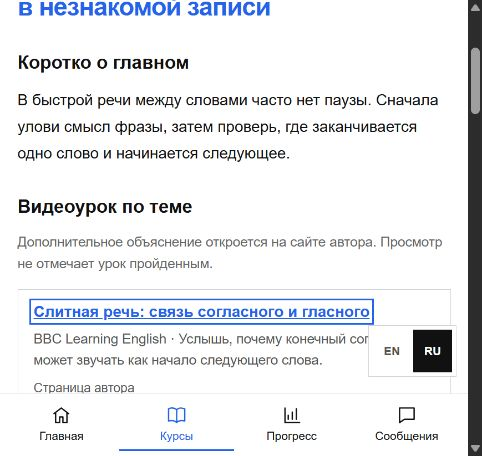

# IELTS topic videos in Meta

Curated 1 November 2026. `meta-ielts-videos.js` maps a lesson's section and English title to a short, reviewed list of external videos. Matching requires a relevant topic term; an unrelated section overview is not attached merely to fill a gap. The block is absent when no reviewed match exists. An external click does not write progress or mark completion.

| Topic | Publisher and video page |
| --- | --- |
| Word linking and weak sounds in Listening | [BBC Learning English, Tim's Pronunciation Workshop](https://www.bbclearningenglish.org/programme/tims-pronunciation-workshop) and the linked consonant–vowel / schwa videos |
| Predicting and following meaning in Listening | [British Council Listening video](https://takeielts.britishcouncil.org/teach-ielts/teaching-resources/videos/listening) |
| Skimming, scanning and close reading | [British Council Reading video](https://takeielts.britishcouncil.org/teach-ielts/teaching-resources/videos/reading) |
| Writing Task 1, Task 2, coherence, vocabulary and grammar | [IELTS Writing video series and transcripts](https://ielts.org/take-a-test/preparation-resources/writing-test-resources) |
| Speaking fluency, vocabulary, grammar and pronunciation | [British Council Speaking videos](https://takeielts.britishcouncil.org/teach-ielts/teaching-resources/videos/speaking-fluency-and-coherence), including the related criterion pages |

These are supporting explanations, not Meta-authored lessons or official scoring of a learner's work. British Council's series is presented for teachers but also contains preparation advice. Keep the link and publisher visible. No third-party player loads until a learner clicks, avoiding automatic external requests and allowing the source page's own transcript when available.

The next content pass should identify gaps in the 332-title catalog and add only videos whose content directly explains the target skill. This mapping is deliberately incomplete; a misleading match is worse than no video. Review links periodically because publishers can move or remove videos.

## Local visual QA

Captured at a narrow mobile viewport using the isolated local QA fixture. The example learner state and surrounding lesson text are mock data; this is not a production account or deployed page.
