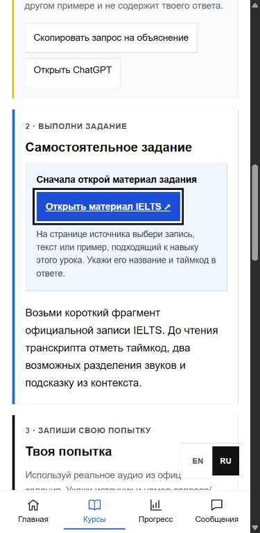

# IELTS and Flutter lesson flow

1 November 2026. Both lesson pages now show four numbered phases: learn, task, attempt, review. IELTS places the external practice source before the task text as a large, labelled action. The source can lead to a general official sample page, so the UI explicitly asks the learner to select a relevant recording/text and record its title and timecode.

The pre-task **explanation prompt** copies the lesson topic, explanation, example, task, criteria and (for IELTS) exercise source. It contains no saved answer or note and asks the AI to explain prerequisites and a different example without completing the exact task. The post-attempt **review prompt** still contains the learner's answer and criteria. Nothing is sent automatically.

The old separate self-check panel and its checkbox gate were removed. Criteria remain visible as a static list in the review phase and are still included in both AI prompts. Completion still requires an authenticated account, a nonempty answer, the learner's confirmation of AI review and the learner's confirmation that the result meets the criteria. This is self-attested completion, not an automatic grade. Existing lesson IDs, answers, notes, submissions and progress rows are untouched. Saving a draft still does not count as completion.

This is an isolated local QA page with mock lesson and learner data. The local browser suite passed 321 checks, including guest/auth flows, progress preservation, RU/EN and 375/390/768/1440 px widths. No production data was changed.
